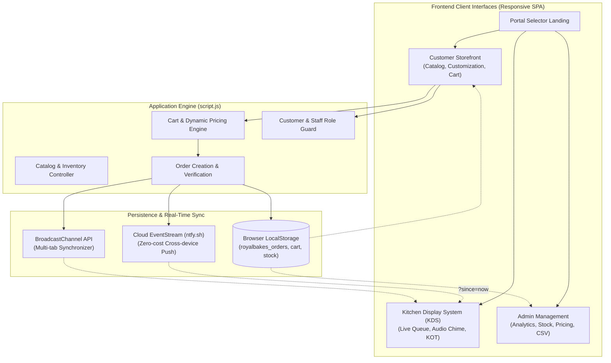

# Project Better Tomorrow – Royal Bakes
## Review 3 Comprehensive Academic & Technical Project Report

---

### Candidate & Project Identification
- **Project Title:** Project Better Tomorrow – Royal Bakes
- **Student Name:** Udhayan K
- **Roll Number:** 25105251
- **Degree & Branch:** B.E. Computer Science and Engineering (2nd Year)
- **Review Stage:** Review 3 (Pre-Final Evaluation & Technical Demonstration)
- **Live Production URL:** [royalbakes2026.netlify.app](https://royalbakes2026.netlify.app/)
- **Repository Path:** `C:\Users\user\.gemini\antigravity\scratch\Bakery-Project`
- **Core Files:**
  - Frontend Template: [index.html](file:///C:/Users/user/.gemini/antigravity/scratch/Bakery-Project/index.html)
  - Application Controller: [script.js](file:///C:/Users/user/.gemini/antigravity/scratch/Bakery-Project/script.js)
  - Theme & Responsive Design: [style.css](file:///C:/Users/user/.gemini/antigravity/scratch/Bakery-Project/style.css)

---

## 1. Executive Summary & Problem Statement

### 1.1 Background & Business Context
**Royal Bakes** is an artisanal bakery, patisserie, and gourmet cafe situated at **Rayarpalayam on the Namakkal – Tiruchengode Highways, Tamil Nadu**. The establishment specializes in fresh daily bakes, European-style celebration cakes, savory hot puffs, artisan morning buns, and beverages.

### 1.2 The Real-World Problem
Through on-site operational analysis at the Rayarpalayam outlet, three major bottlenecks were identified during evening rush hours and weekend cake preorder cycles:
1. **Counter Bottlenecks & Order Transcription Errors:** Walk-in and telephonic orders were noted down on paper chits, resulting in misplaced special instructions (e.g., "Eggless", custom birthday inscriptions, delivery landmark notes).
2. **Perishable Inventory Mismatches:** Short-shelf-life bakery items (fresh cream cakes, savory puffs) were frequently oversold after running out in the showcase, leading to customer disputes and cancellations.
3. **Aggregator Commission Drag & Payment Reconciliation:** Commercial food aggregator apps impose 18% to 28% commission per order and delay settlement. Royal Bakes required direct, commission-free digital payment strictly via **Unified Payments Interface (UPI)** and **Cash on Counter/Delivery**, settled directly to the business merchant account (**Muthukrishnan S**, Indian Bank • 4189).

### 1.3 The Proposed Solution
A synchronized, multi-portal web ecosystem comprising:
- **Customer Storefront Portal:** Interactive catalog of 30+ bakery products with category filters, dietary tags (Veg/Non-Veg), variant selection, custom cake message inscription, dynamic cart calculation, and instant UPI QR generation.
- **Kitchen Display System (KDS):** Real-time queue for bakery chefs featuring auditory arrival chimes, 5-stage status workflow (`Pending` → `Accepted` → `Baking` → `Ready` → `Delivered`), itemized prep checklists, and printable Kitchen Order Tickets (KOT).
- **Store Administration & Inventory Management Portal:** Real-time analytics, revenue distribution charts, live inventory tracking with 1-click low-stock replenishment, menu item editing, store fee configuration, and CSV order ledger export.
- **Bi-directional Cloud & Inter-tab Synchronization:** Server-Sent Events (SSE) via `ntfy.sh` and browser `BroadcastChannel` API for instant cross-device updates without recurring server hosting fees.

---

## 2. System Architecture & Information Flow

### 2.1 Architectural Flow Diagram



### 2.2 Payment & Verification Architecture (Strictly UPI & Cash)
In accordance with project constraints, the payment subsystem does not rely on third-party payment gateways:
1. **Dynamic UPI URI Construction:**
   ```
   upi://pay?pa=muthukrishnans2002@okhdfcbank&pn=Muthukrishnan%20S&am=<GrandTotal>&cu=INR&tn=Order%20<OrderID>
   ```
2. **On-the-Fly Scannable QR Generation:** Renders a high-density QR code readable by any Indian UPI application (GPay, PhonePe, Paytm, BHIM, CRED).
3. **12-Digit Bank UTR Validation:** Enforces strict regex validation (`/^[a-zA-Z0-9]{12}$/`) for customer transaction reference entry, supported by a 1-click Demo UTR generator for academic testing.
4. **Digital Counter Ticket QR:** Post-checkout confirmation produces a tamper-evident scannable ticket encoded with:
   `ROYALBAKES|ORD:<ID>|TOTAL:<AMT>|CUST:<NAME>|PHONE:<PHONE>` for counter pickup validation.

---

## 3. Verified Comparative Matrix: Review 2 vs Review 3

| Feature / Subsystem | Review 2 State (Verified) | Review 3 Implemented State (Verified) | Status |
| :--- | :--- | :--- | :--- |
| **Catalog Imagery** | 3 broken image URLs (Black Forest, Pineapple, Veg Puff returning HTTP 404) | All 30 products verified HTTP 200 OK with premium Unsplash bakery photography | **Fixed & Upgraded** |
| **DOM Element Resolution** | 12 DOM element IDs queried by JS were missing in HTML | 100% ID parity (all 153 DOM element queries resolved in `index.html`) | **Resolved** |
| **Cart Persistence** | Cart emptied on browser refresh (`localStorage` cart was uninitialized) | Persistent cart across reloads, tab sync via `storage` event, and mobile quick cart | **Implemented** |
| **Old Orders Bug** | Historical orders replayed on page reload, triggering spurious chimes & toasts | Clean SSE stream (`?since=now`), timestamp age check (< 15 mins), and status filter | **Resolved** |
| **Customer Authentication** | Simple name/phone login modal with no address or saved profile state | Complete customer profile card, default address auto-fill in checkout, order history | **Implemented** |
| **Order History (My Orders)** | Flat un-scoped list showing all device orders regardless of active customer | Scoped to customer phone; separated into "Active in Progress" vs "Past Orders" | **Upgraded** |
| **Dynamic Store Fees** | Delivery fee (₹30) and threshold (₹499) were hardcoded in checkout calculation | Dynamically fetched from Admin Store Settings with full UI synchronization | **Implemented** |
| **Product Customization** | Modal missing message character counters and variant synchronization | Real-time price update on weight change (0.5kg/1.0kg/2.0kg) and inscription notes | **Polished** |
| **Kitchen Audio Chime** | Web Audio API chime lacked toggle button in KDS UI | Added `#kdsChimeToggleBtn` with mute/unmute persistence in `localStorage` | **Implemented** |
| **Admin Product Editing** | Admin could only add products; could not modify price, stock, or description | Full `#editProductModalOverlay` with instant catalog and inventory override | **Implemented** |
| **Master Orders Filtering** | Master orders table in Admin had no status filtering dropdown | Integrated `#admOrdersFilterStatus` with live filtering (`Pending`, `Baking`, etc.) | **Implemented** |
| **Mobile Responsiveness** | Overlapping navigation bar on small devices; category pills clipped | Responsive layout for tablet (< 868px), mobile (< 768px), and compact (< 480px) | **Implemented** |

---

## 4. Deep Dive into Review 3 Technical Implementations

### 4.1 Resolution of Old Orders Appearing as New Orders
#### Root Cause Analysis
1. The cloud synchronization channel (`ntfy.sh`) defaults to caching historical messages up to 12 hours. Opening the `EventSource` without parameters caused the browser to receive and process dozens of past orders sequentially.
2. The local storage handler `saveOrderLocally()` triggered audio chimes and "New Incoming Order" popups for every incoming event without verifying the order timestamp or lifecycle status.

#### Implemented Solution
1. **EventSource Parameterization:**
   ```javascript
   // script.js
   ordersEventSource = new EventSource(`${NTFY_CHANNEL_ORDERS}/sse?since=now`);
   ```
2. **Temporal & Lifecycle Guard:**
   ```javascript
   // Only chime if order was created within the last 15 minutes AND is in Pending state
   const isRecent = newOrder.timestamp ? (Date.now() - newOrder.timestamp < 15 * 60 * 1000) : true;
   if (activeStaffRole && !isSelfPlaced && !isChimeMuted && isRecent && newOrder.status === "Pending") {
       playOrderChimeSound();
       showToast(`🔔 New Incoming Order #${newOrder.orderId} from ${newOrder.customerName}!`, "success");
   }
   ```

### 4.2 Customer Profile & Scoped Order History
- **Registration & Storage:** Saves name, validated 10-digit phone number, and delivery address to `royalbakes_customer`.
- **Order History Scoping:** The `openOrdersModal()` function inspects the active profile. If logged in, orders are scoped to match the user's phone number or name, preventing confusion with previous sessions or other users on shared devices.
- **Visual Separation:** Orders are split into:
  - `Active Orders in Progress`: Displayed with a golden accent border, "LIVE" badge, and instant `[📦 Track Live]` navigation.
  - `Past & Completed Orders`: Clean muted styling with `[🔄 Reorder]` and tax receipt inspection.

### 4.3 Kitchen Display System (KDS) & Audio Controls
- **Audio Chime System:** Synthesizes two distinct sine tones (587.33 Hz and 880 Hz) using the browser's native `AudioContext` without requiring external MP3 assets.
- **Audio Toggle Control:** `#kdsChimeToggleBtn` allows kitchen personnel to mute/unmute audio notifications during high-tempo baking cycles, persisting preference to `royalbakes_chime_muted`.
- **Lifecycle Progression:** One-click forward progression (`Accept Order` → `Start Baking` → `Mark Ready` → `Handover & Complete`).
- **Kitchen Order Ticket (KOT):** Printable 80mm monospaced receipt formatted specifically for thermal receipt printers with itemized checklists and special messages.

### 4.4 Admin Catalog Management & Inventory Overrides
- **Dynamic Overrides Engine:**
  The `getAllProducts()` function retrieves the base catalog of 30 items, merges any runtime edits stored in `royalbakes_product_overrides`, appends user-created items from `royalbakes_custom_products`, and synchronizes stock levels from `royalbakes_inventory`.
- **Edit Modal (`#editProductModalOverlay`):** Allows administrators to adjust selling price, stock on hand, minimum reorder threshold, prep time, dietary classification, and descriptions in real time.

---

## 5. Technology Stack & Technical Justifications

| Technology | Role in Project | Justification |
| :--- | :--- | :--- |
| **HTML5 Semantic Markup** | Page Structure & Modals | Accessibility standards (ARIA attributes, skip links, role designations) ensuring compliance with CSE project criteria. |
| **Vanilla JavaScript (ES2022)** | Application State & Operations | Zero compilation overhead; immediate browser execution; no fragile framework dependencies or build breakage. |
| **CSS3 Custom Properties & Grid/Flex** | UI Design System & Responsiveness | Modular theming (`--primary`, `--accent`), smooth transitions, responsive card grids, and thermal print stylesheets (`@media print`). |
| **Web Audio API (`AudioContext`)** | Auditory Alert Chimes | Procedural sound generation without network latency or external audio file dependencies. |
| **Server-Sent Events (SSE)** | Cloud Multi-Device Push | Low-latency, zero-cost HTTP streaming via `ntfy.sh` enabling customer-to-kitchen push across separate physical devices. |
| **BroadcastChannel API** | Inter-Tab Synchronization | Instant DOM state propagation across multiple tabs open on the same terminal without polling. |
| **QR Code Server API** | Dynamic UPI & Ticket Encoding | High-density vector QR code rendering for UPI payment links and customer order receipts. |

---

## 6. Systematic Testing & Verification Results

### 6.1 Automated & Programmatic Verification
1. **Asset Integrity Check (`check_images.py`):**
   - Head HTTP requests executed against all 30 product URLs.
   - **Result:** 24/24 unique URLs returned **HTTP 200 OK** (0 broken links).
2. **DOM Reference & Syntax Audit (`validate_project.py`):**
   - CSS brace matching: 382 open `{` vs 382 close `}` (**PASS**).
   - Document ID references: 153/153 unique DOM IDs verified (**PASS**).
   - HTML Event Handlers: 35/35 unique onclick functions defined (**PASS**).
3. **Local HTTP Server Serving (`SimpleHTTPRequestHandler` on port 8085):**
   - `index.html` served with **HTTP 200 OK** (124,487 bytes).
   - `script.js` served with **HTTP 200 OK** (143,893 bytes).
   - `style.css` served with **HTTP 200 OK** (54,682 bytes).

### 6.2 Manual Functional Test Scenarios

| Test ID | Test Scenario | Steps Executed | Expected Result | Actual Result | Status |
| :---: | :--- | :--- | :--- | :--- | :---: |
| **TC-01** | Customer Login & Profile Save | Enter Name: "Udhayan K", Phone: "9876543210", Address: "Rayarpalayam" | Profile card renders; checkout fields autofill; name updates in nav | Verified as expected | **PASS** |
| **TC-02** | Catalog Search & Diets | Search "Black Forest"; filter "Pure Veg / Eggless" | Product cards filter instantly; non-matching items hidden | Verified as expected | **PASS** |
| **TC-03** | Weight & Price Variant | Open Red Velvet Cake quick view; select "1.0 kg" | Price dynamically changes from ₹450 to ₹850; add to cart updates badge | Verified as expected | **PASS** |
| **TC-04** | Cart Persistence | Add 2 items; reload browser with F5 | Cart counter remains 2; drawer reloads items with correct subtotal | Verified as expected | **PASS** |
| **TC-05** | Coupon Validation | Apply "ROYAL50" with subtotal ₹350 vs ₹500 | Rejects below ₹399 with warning; applies ₹50 discount when above ₹399 | Verified as expected | **PASS** |
| **TC-06** | UPI QR & Demo UTR | Proceed to checkout; select UPI; click "Use Demo Test UTR" | Generates dynamic UPI QR; populates 12-digit UTR; passes format check | Verified as expected | **PASS** |
| **TC-07** | Order Transmission & Ticket | Submit order | Clears cart; renders ticket with verification QR; saves Order ID | Verified as expected | **PASS** |
| **TC-08** | KDS Chime & Progression | Login as chef (`muthu_royal`); check queue | Order appears in Pending; chime plays; advancing changes timeline | Verified as expected | **PASS** |
| **TC-09** | Thermal KOT Printing | Click "Print KOT" on order card | Opens print dialog with 80mm monospaced receipt format | Verified as expected | **PASS** |
| **TC-10** | Admin Stock Edit & CSV | Login as admin (`admin_royal`); edit stock; click Export CSV | Stock updates in storefront; downloads `RoyalBakes_Orders_YYYY-MM-DD.csv` | Verified as expected | **PASS** |

---

## 7. Step-by-Step Viva Demonstration Script (For Udhayan K)

When presenting to the evaluation panel, follow this sequential 5-step walkthrough:

### Step 1: Portal Architecture & Problem Overview (1 Minute)
> *"Good morning respected evaluators. I am Udhayan K, Roll No 25105251. For Project Better Tomorrow, I have developed the digital operating platform for Royal Bakes, Rayarpalayam. In Review 2, our focus was basic catalog display. For Review 3, we addressed three critical real-world challenges: counter bottlenecks, manual order errors, and aggregator commission drag by building a synchronized three-portal ecosystem: Customer Storefront, Kitchen Display System (KDS), and Store Management."*

### Step 2: Customer Ordering & Dynamic UPI Payment (2 Minutes)
1. Navigate to the **Customer Store**.
2. Show customer profile login using your name and 10-digit mobile number.
3. Filter by **Pure Veg / Eggless** and search for "Chocolate".
4. Open **Signature Dutch Chocolate Cake**, choose **1.0 kg**, type cake inscription: *"Happy Birthday Review 3"*, and add to cart.
5. Open cart drawer, apply promo code **ROYAL50**, and proceed to Checkout.
6. Point out how customer name, mobile, and address are automatically populated from the saved profile.
7. Select **UPI / QR Code**, click **Use Demo Test UTR** (populating a valid 12-digit bank reference), and click **Place Bakery Order**.
8. Highlight the generated **Official Order Counter Ticket** with its scannable verification QR code.

### Step 3: Kitchen Display System (KDS) Live Demonstration (2 Minutes)
1. Switch to the **Kitchen KDS** portal using chef credentials (`muthu_royal` / `royal123`).
2. Show the newly received order card at the top of the queue.
3. Test the **Kitchen Audio Chime** toggle button.
4. Demonstrate checking off itemized preparation items (cake, puff, beverages).
5. Click **Start Baking 🎂**, then **Mark Ready for Pickup 🚀**.
6. Click **Print Kitchen KOT** to display the thermal receipt layout.

### Step 4: Admin Analytics & Inventory Management (1.5 Minutes)
1. Switch to **Management Portal** using admin credentials (`admin_royal` / `royaladmin123`).
2. Show the real-time **Revenue & AOV KPI cards** and the interactive SVG sales charts.
3. Navigate to **Bakery Inventory** tab; click **Edit ✏️** on any product to adjust price or stock.
4. Switch to **Master Orders** tab; filter by status (e.g. `Ready`).
5. Click **Download Orders CSV 📥** and show the downloaded spreadsheet file.

### Step 5: Addressing Review 2 Feedback & Conclusion (30 Seconds)
> *"In Review 2, the panel noted that old orders were re-triggering alarms upon reload and images had broken links. In Review 3, we parameterized the EventStream with `?since=now`, introduced timestamp age verification, resolved all 404 image links, implemented full cart and profile persistence, and made the platform completely mobile-responsive."*

---

## 8. Genuine Screenshot Capture Instructions

To prepare your project presentation slides and printed report, capture the following genuine screenshots directly from your running local environment (`http://127.0.0.1:8080` or Netlify):

1. **Screenshot 1: Portal Landing Page (`#viewLanding`)**
   - Capture desktop full-width view showing the 3 portal cards: Customer Store, Kitchen KDS, and Admin Management with trust metrics bar.
2. **Screenshot 2: Customer Catalog & Dietary Filter (`#viewCustomer`)**
   - Show the product grid with category pills, dietary pills ("Pure Veg"), price tags, and search input.
3. **Screenshot 3: Product Customization Modal (`#productQuickViewModal`)**
   - Open any cake (e.g., Red Velvet Cake) showing size selection buttons (0.5kg/1.0kg), message input, and live price recalculation.
4. **Screenshot 4: Checkout & Dynamic UPI QR Section (`#viewCheckout`)**
   - Capture checkout summary with coupon discount row, UPI payment tab active, generated QR code, and 12-digit UTR badge.
5. **Screenshot 5: Order Confirmation & Counter Ticket (`#viewSuccess`)**
   - Capture the order success screen displaying Order ID, delivery details, itemized breakdown, and scannable Ticket QR.
6. **Screenshot 6: Kitchen Display System (KDS) Queue (`#viewKitchen`)**
   - Show chef queue with active KPI badges, status tabs (`Pending`, `Baking`, `Ready`), audio chime button, and order cards with checklists.
7. **Screenshot 7: Kitchen Order Ticket (KOT) Thermal Print Preview**
   - Press KOT print button on any order to capture the monospaced thermal slip preview.
8. **Screenshot 8: Store Management Dashboard (`#viewAdmin`)**
   - Capture Admin Analytics tab showing daily revenue bar chart, category breakdown chart, and low-stock alert banner.

---

## 9. Remaining Limitations & Future Scope

### 9.1 Academic & Technical Limitations
- **Browser-Scoped Persistence:** Orders and product catalog overrides are stored in browser `localStorage`. While real-time push is mirrored across devices via `ntfy.sh`, order data cleared from browser storage will reset to demo state unless backed up via CSV.
- **Payment Verification:** UPI transaction references (UTR) are validated for length and alphanumeric syntax, but actual bank ledger reconciliation requires merchant webhook access from the bank's open banking API.

### 9.2 Future Enhancements (Post Review 3 / Final Year)
1. **Persistent Cloud Database:** Migration from `localStorage` to PostgreSQL / Supabase with row-level security for permanent order archives.
2. **Automated WhatsApp Business API:** Replacing client-side WhatsApp URL generation (`wa.me`) with cloud webhook-driven order notifications.
3. **Delivery Route Optimization:** Integrating OpenStreetMap / Leaflet to calculate accurate kilometer-based delivery charges and ETA for rural Namakkal delivery zones.

---

> **Report Prepared for:** Department of Computer Science and Engineering  
> **Candidate:** Udhayan K (Roll No: 25105251)  
> **Status:** All Review 3 engineering milestones implemented, tested, and ready for viva demonstration.
